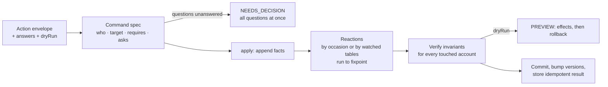

# Architecture: post-research draft (stage 3 of 4)

> Stage 3 of deliverable 4.1. Written after reading the field-desk codebase and the canonical rules, and after discussing them with Claude (Opus 5.5). Stage 1 (first draft) and stage 2 (refined draft) come before this and should be written by me, without the LLM. Stage 4 (final) records what was actually built.

## 1. What the codebase does today

field-desk is a NestJS + Drizzle + SQLite CRM. Its server is about 7.4k lines, with 20 action commands across 8 business modules. One `POST /actions` endpoint runs every command inside a single immediate SQLite transaction (`ActionsService`). A nested savepoint lets a rejected command roll back while still storing its idempotent result.

The code already has three good mechanisms:

| Mechanism | Where | Why it matters |
| --- | --- | --- |
| Append-only, signed ledgers with reversal links | allocations, credit applications/refunds, reward postings, charge adjustments (`adjusts_id`) | WF-001 (history preservation) is already the storage model, so corrections can be compensating rows. |
| Reconcile-to-target for rewards | `RewardsService.refresh` | It recomputes entitlement and earned points from facts and posts only the delta. This is the "state reconciliation" pattern, already working for one ledger. |
| Global invariant review before commit | `AuditService.review(customerId)` | It checks quantity partitions, reward accrual, charge and receipt capacity. Any failure rolls the command back. This is the safety net that makes refactoring safe. |

### Where the combinatorial explosion shows

1. **Reactions are hand-wired.** The tail `allocateCash(c); rewardsService.refresh(c)` is copied into 5 handlers (deliver, correct, return, receive, allocate), with a sixth `refresh` in orders. WF-002 ("which occasions trigger cash allocation") exists only as the pattern of where someone remembered to paste it. Each new command forces a decision about which tails to paste.
2. **Unwinding is written once per feature.** Return settlement (WF-003) spends about 150 lines releasing over-settlement on a charge: cash, then credit, then points. FDSK-170 needs exactly the same unwind. FDSK-169 needs its mirror image, releasing a *receipt's* allocations instead of a *charge's*.
3. **Formulas are duplicated.** Reward earning is computed in `RewardsService` (via `RewardEntitlement`) and again in `AuditService` (BigInt arithmetic). Charge outstanding is recomputed inline in at least 4 places.
4. **The engine assumes one aggregate.** `ActionContext.customerId` is a single string. The version bump, `expectedVersion` check and audit review all target one customer. FDSK-169 is the first command that touches two customer accounts.
5. **Ambiguity questions are one-shot and can't be answered.** `DomainDecision` is thrown once (correction location), and the client only joins the prompts into an error toast. Nothing lets the user answer a question and resubmit.
6. **The rules are not readable in code.** Canonical rule IDs (ORD-005, WF-003, …) appear nowhere in the source. To check that the code matches the rules, you have to read every service.

## 2. The key insight for the two features

Both user stories **shrink a capacity that has already been consumed**:

| Story | What shrinks | Invariant that breaks | What has to be released |
| --- | --- | --- | --- |
| FDSK-170: overstated delivery | A charge's retained value $v_j$ (delivered units go from 10 to 6) | ACC-001: $b_j = v_j - c_j - k_j - z_j \ge 0$ | Settlement on that charge: cash, then credit, then points |
| FDSK-169: wrong-customer payment | A receipt's effective amount $m_i$ on Northside (₹10,000 to ₹0) | ACC-002: $u_i = m_i - a_i - f_i \ge 0$ | That receipt's allocations (and credit funding) |
| Existing: returns (WF-003) | A charge's retained value | ACC-001 | Settlement on that charge |

So the design does not add two bespoke features. It adds **one capacity-restoring reconciler**, with release order as a declared policy, and then:

- FDSK-170 = *record a delivery reversal and a charge adjustment*. The reconciler releases what no longer fits, WF-002 re-allocates the freed cash, and the rewards reconciler moves points from AVAILABLE back to LOCKED (or to clawback).
- FDSK-169 = *record a receipt transfer out of Northside and a linked receipt into Greenfield*. The reconciler releases Northside's allocations, and cash allocation and rewards run on both accounts.
- Return settlement is rewritten on the same reconciler, which proves it is general: the existing return tests must stay green.

## 3. Proposed architecture: Command → Rules → Reconcile → Verify



### 3.1 Command specs (replace the 20-case switch)

Each command is declared once, with its rule ID, roles, target aggregate(s), preconditions and questions. A nontechnical reader can review the spec without reading handlers.

```ts
export const correctDelivery = command('CORRECT_DELIVERY', {
  rule: 'FUL-007',
  title: 'Correct an overstated delivery confirmation',
  who: ['KAM'],                       // Admin is implicit
  targets: (p) => [order(p.orderId)],
  requires: [
    when('shipment is DISPATCHED or DELIVERED', ...),
    when('corrected quantity is below what was confirmed', ...),
    when('corrected quantity still covers returned units (FUL-001)', ...),
  ],
  apply: (tx, p) => reverseDeliveries(tx, p),   // facts only
});
```

The engine derives authorization, `NOT_FOUND` handling, version checks and audit attribution from the spec. Handlers shrink to "which facts to append".

### 3.2 Reactions (declared once, not pasted)

| Reaction | Trigger | Rules |
| --- | --- | --- |
| Restore capacity: release over-settlement per charge and over-allocation per receipt | Watches `receivable_entries`, `receipt_transfers` | ACC-001, ACC-002, WF-003 release order |
| Cash allocation | **Occasion list**: receive payment, delivery confirmation, additional-goods correction, return settlement, explicit allocation, *+ delivery correction, + payment re-attribution* | ACC-003, WF-002 |
| Reward buckets | Watches allocations, charges, order status, cancellations, returns | REW-001 to REW-003 |

A design subtlety worth stating in the interview: cash allocation **must not** be purely table-reactive. WF-002 explicitly says other operations (for example credit-application reversal, which reopens a charge) do *not* trigger allocation. So reactions come in two kinds: **policy-triggered** (an occasion list that mirrors WF-002 one-to-one) and **data-triggered** (watched tables, discovered from the `effects` the context already records). The engine runs them in declared order until nothing changes, with an iteration cap as a guard.

### 3.3 Multi-aggregate context

- `ActionContext.customerId: string` becomes `touched: Set<customerId>`. Each repository write registers its customer.
- The envelope gets `expectedVersions?: Record<aggregateId, number>`. The existing single `expectedVersion` stays valid for the primary target.
- Version bump, reactions and `AuditService.review` run **for every touched customer**. CUS-001 (account boundary) becomes something the engine can check: no allocation, application or funding row may join records from two customers.

### 3.4 Questions and preview

- `c.ask(key, prompt, options)` returns the answer from `envelope.answers[key]` if present. Otherwise it records the question and lets the handler continue validating. At the end, *all* open questions come back in one `NEEDS_DECISION` result instead of one per round-trip.
- `dryRun: true` runs the full pipeline inside the savepoint, returns status `PREVIEW` with effects and review, and then rolls back. This is the "(action, payload, state) → mutations | questions" function from the brief, at no extra cost: the savepoint machinery already exists.
- Client: one generic decision dialog that renders options and resubmits with `answers`, plus a "Review changes" step that shows the preview before Apply.

### 3.5 Single source for formulas

`ChargeBalance`, `ReceiptBalance`, `CreditBalance` and `RewardEntitlement` become the only implementations, used by services, reactions *and* the audit review. Today the audit re-derives them independently. Keeping a deliberately independent check is a fair argument, so the audit gets property-based tests instead of a second implementation.

## 4. Feature designs

### FDSK-170: Correct an overstated delivery confirmation (new rule FUL-007)

**Command** `CORRECT_DELIVERY`, roles KAM and Admin.
Payload: `{ orderId, shipmentId, items: [{ shipmentLineId, deliveredQty }], reason, evidence }`.
`deliveredQty` is the corrected *total* ("correct ten to six"), not a delta, because that matches how the KAM describes the mistake.

**Rules**
- $r_h \le d'_h < d_h$: you cannot un-deliver units that were already returned, and the correction must reduce the count.
- The reduced units revert to *dispatched, not delivered* (in transit). $s_h$ and order demand are unchanged, so ORD-001 holds automatically.
- Delivery confirmations are reversed **latest first**. Each reversal is a negative `deliveries` row with `reversal_of_id`, which mirrors the existing credit-refund reversal pattern.
- Each reversed confirmation's charge gets an adjustment of kind `DELIVERY_CORRECTION`, value $-q\,p_h$, linked through `adjusts_id` (WF-005 stays one charge per confirmation).
- Shipment status `DELIVERED` goes back to `DISPATCHED`. This adds a transition to FUL-006.
- Reactions: the capacity reconciler releases settlement above the new retained value (cash, then credit, then points, in reverse order of first application, as in WF-003). **Released cash becomes free cash**, not a credit note. This deliberately differs from returns: nothing was returned, a record was wrong, so WF-002 re-allocates the cash to other outstanding charges or leaves it as an advance. Rewards move earned points back to LOCKED; points already spent become clawback pending (REW-003).
- Later, Warehouse confirms the other 4 with the ordinary `CONFIRM_DELIVERY`. No special path is needed.

**Schema**: relax `deliveries_qty_check` to `qty > 0 and reversal_of_id is null OR qty < 0 and reversal_of_id is not null`, and add `reversal_of_id`, `reason` and `evidence` columns. This needs one migration.

### FDSK-169: Move a payment recorded against the wrong customer (new rule ACC-004)

**Command** `REATTRIBUTE_PAYMENT`, roles Accounts and Admin, targets *both* customers.
Payload: `{ customerId, receiptId, targetCustomerId, amountPaise?, reason, bankReference, expectedVersions }`. If `amountPaise` is omitted, the whole remaining receipt moves. A partial move covers a bank transfer that paid for two customers.

**Rules**
- Receipts stay immutable (WF-001). A new `receipt_transfers` row (from, to, amount, reason, bank reference, new receipt) reduces the source receipt's effective amount: $m'_i = m_i - \sum \text{transfers out}$. ACC-002 is restated over $m'_i$.
- A new receipt is created on the target customer with `transferred_from_receipt_id` and the original bank reference.
- On Northside, the capacity reconciler releases the receipt's allocations in reverse order of first allocation. WF-002 then lets Northside's *other* free cash re-settle the reopened charges, and rewards claw back points that are no longer cash-backed.
- On Greenfield, WF-002 allocates the new receipt by ACC-003 and rewards refresh.
- **Credit funded by the moved receipt** (CRD-001):
  - unused open credit: shrink the funding (needs a signed funding adjustment);
  - credit already applied to a charge: **question**, "Reversing this payment also reverses ₹X of credit applied to charges A and B. Proceed?";
  - credit already refunded: **reject**. Northside was paid out with Greenfield's money, which needs recovery outside the system. Say so plainly.
- Both accounts get a version check, an invariant review and an audit event on each timeline.

## 5. Two solutions (bonus deliverable 2)

| | **A. Middle ground** (recommended to ship) | **B. Rules engine** (demonstration slice) |
| --- | --- | --- |
| Shape | Command registry, reaction pipeline, capacity reconciler, multi-aggregate context. Services keep their handlers. | Rules as data: lifecycle tables (ORD-005 as a literal table), `when/then` specs, invariants named by rule ID, reactions sorted topologically, and a generated human-readable rule book. |
| Framework code | About 500 lines | About 1,500 lines or more |
| Business code change | Handlers shrink, return settlement gets about 60% shorter | Handlers become mostly declarations |
| Readable by non-engineers | Specs plus rule IDs in code | Yes: the rule book is generated from the specs |
| Risk | Low: same tests, same storage | Higher: indirection, debugging through the engine |
| Scope here | Whole codebase plus both features | Orders and fulfillment state machines plus invariants only, on a branch |

Deliverable 3 (when to invest in which) gets its own document: a decision tree built from measurable signals. Examples: commands × derived ledgers, number of hand-wired reaction sites, files touched per rule change, how often rules change, cross-aggregate commands, and whether non-engineers must sign off on rules.

## 6. Plan

### Commit sequence (small, logical, history kept as it happened)

| # | Commit | Stage |
| --- | --- | --- |
| 0 | Push the original history to the new private repo | Setup |
| 1 | `docs: first-draft architecture` (**mine, no LLM**) | 4.1 |
| 2 | `docs: refined architecture` (mine, after reading the code) | 4.1 |
| 3 | `docs: post-research architecture` (this document) | 4.1 |
| 4 | `test: pin return-settlement effects before refactor` (characterization tests) | Safety |
| 5 | `refactor: declare commands in a registry instead of a switch` | A |
| 6 | `refactor: run WF-002 cash allocation and reward refresh as declared reactions` | A |
| 7 | `refactor: extract the WF-003 release policy into a capacity reconciler` | A |
| 8 | `feat(engine): track touched accounts; version-check and review each` | A |
| 9 | `feat(engine): batch decision questions; answers and dry-run preview` | A |
| 10 | `feat(schema): delivery reversals` → `feat: FDSK-170 correct overstated delivery` (+ tests) | Feature |
| 11 | `feat(schema): receipt transfers` → `feat: FDSK-169 re-attribute payment` (+ tests) | Feature |
| 12 | `docs(rules): add FUL-007, ACC-004; update FUL-006, ACC-002, WF-002` | Rules |
| 13 | `feat(client): decision dialog, change preview, two action forms` | UI |
| 14 | `docs: when to invest in a rules framework` | D3 |
| 15 | Branch `solution-b`: lifecycle tables, named invariants, generated rule book | Bonus |
| 16 | `docs: final architecture`, `Evaluator_notes.md`, chat export | D4, D5, D7 |

### Test scenarios (each one becomes a test)

- **FDSK-170**:
  - 10 delivered and unpaid, corrected to 6: charge drops by 4p, shipment back to DISPATCHED, then confirm the other 4 later.
  - Fully cash-paid: the freed cash settles an older outstanding charge.
  - Paid by credit: the credit goes back to its note.
  - Paid by points: points are restored.
  - Points earned and already redeemed: clawback pending.
  - 3 already returned, correct to 2: rejected.
  - Correction on a WF-004 supplement shipment.
- **FDSK-169**:
  - Unallocated advance: moves cleanly.
  - Fully allocated (the brief's example): Northside's charges reopen and its points are clawed back; Greenfield's charges are settled.
  - Partial move.
  - Funded open credit.
  - Applied credit: a question, then success on answer.
  - Refunded credit: rejected.
  - Moving to the same customer: rejected.
  - A stale version on either customer: conflict.
- **Regression**: every existing test passes, and the audit review passes after every command.

### Time budget (deadline 31 Oct)

| Priority | Items | Estimate |
| --- | --- | --- |
| Must | 0 to 3, 10 to 12, 14, 16 (FDSK-169 and FDSK-170 directly on the reconciler, with docs) | About 6 h |
| Should | 4 to 9 (solution A refactor) | About 4 h |
| Could | 13 (UI), 15 (solution B slice) | About 3 h or more |

If time runs short, solution A's reconciler (#7) still comes first, because both features build on it. The registry and reaction refactors (#5, #6) are the ones to cut.

## 7. Open decisions

1. **Credit funded by a moved receipt (FDSK-169).** Do the full unwind as described, or reject with guidance in v1 and document it as a known limitation? Recommendation: support unused open credit and the applied-credit question; reject refunded credit.
2. **FDSK-170 intent question.** Should the system ask "are the units still in transit, or did they never leave the warehouse?" The story says in transit. "Never left" is really a dispatch correction that changes $s_h$ and open demand, which is a different command. Recommendation: no question; name the command and UI copy for the in-transit meaning, and list dispatch correction as future work.
3. **Released cash on a delivery correction:** free cash (WF-002 re-allocates it) or a credit note (as in returns)? Recommendation: free cash. Nothing was returned to the customer.
4. **Solution B scope.** Is a slice on a branch enough, or should it be skipped in favour of UI polish?
