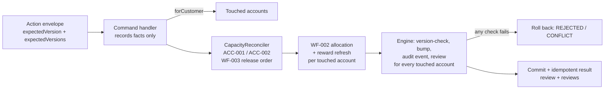

# Architecture: final (stage 4 of 4)

Stage 4 of deliverable 4.1. It records what was actually built, and where that differs from the stage-3 draft (`03-architecture-post-research.md`). Everything was built on deadline day with less than 5 hours of working time. The core came first, and the cuts are listed openly.

## 1. What was built

| Piece | Where | Rules | Status |
| --- | --- | --- | --- |
| Characterization tests for return settlement | `server/test/return-settlement.test.ts` | WF-003 | Built. Pins every ledger row of 5 return scenarios. |
| Capacity reconciler | `server/src/settlement/capacity.reconciler.ts` | ACC-001, ACC-002, WF-003 | Built. Charge side (`releaseChargeOverSettlement`) and receipt side (`releaseReceiptOverAllocation`). |
| Return settlement on the reconciler | `server/src/returns/returns.service.ts` | WF-003 | Built. From 239 to 178 lines, with identical effects. |
| Multi-account engine | `server/src/actions/actions.service.ts`, `forCustomer` in `common/domain.ts` | CUS-001 | Built. |
| FDSK-170 `CORRECT_DELIVERY` | `fulfillment.service.ts#correctDelivery`, migration `0006` | FUL-007 (new), FUL-006, WF-002, WF-005 | Built, 11 scenarios. |
| FDSK-169 `REATTRIBUTE_PAYMENT` | `accounts.service.ts#reattribute`, migrations `0007` and `0008` | ACC-004 (new), ACC-002, CRD-001, CRD-006, WF-002 | Built, including credit handling, 10 scenarios. |
| Rules, API and roles docs | `docs/candidate-walkthrough/*`, `docs/api.md` | | Built, in the same commits as the code. |

### 1.1 The reconciler is what makes the features small

Both stories shrink a capacity that is already in use, so neither feature contains settlement code:

- **FDSK-170.** The handler writes a negative delivery row linked to the confirmation, plus one `DELIVERY_CORRECTION` adjustment on that confirmation's charge, and moves the shipment back to `DISPATCHED`. `releaseChargeOverSettlement` gives back cash, then credit, then points. WF-002 re-allocates the freed cash, and the reward refresh moves points or creates clawback.
- **FDSK-169.** The handler writes a transfer row and a receipt on the right customer. `releaseReceiptOverAllocation` releases the source receipt's allocations that no longer fit, with free cash going first. If the receipt also funds credit, `withdrawCreditFunding` handles it, running first in plan mode so the handler can ask before anything is written: unused credit shrinks, applied credit is reversed once confirmed, and refunded credit blocks the move. WF-002 and rewards then run on both accounts.
- **Returns** are now one more user of the same reconciler. The characterization tests prove nothing changed.

The release order is declared once: `WF003_RELEASE_ORDER = ['cash', 'credit', 'points']`. What happens to released cash stays the caller's rule, because the business rules differ: returns fund a credit note (WF-003), a delivery correction leaves the cash free (decision 2).

### 1.2 The engine knows which accounts a command touched

`ActionContext.touched` starts with the primary account. A handler that acts on another account calls `forCustomer(c, id)`, and that is all it does. The engine then, for each touched account:

1. requires and checks its version (`expectedVersions`, part of the idempotency fingerprint);
2. bumps it and its orders;
3. writes an audit event on its timeline;
4. runs `AuditService.review`, and rolls back if any check fails.

`result.review` stays the primary account's review, for existing clients. `result.reviews` holds all of them.

### 1.3 Effective receipt amount

A receipt is never edited. Its capacity is `effective_paise = amount_paise - Σ transfers out`. The repository exposes it on every receipt row. Allocation, credit issue, the summary and the audit cash check all read that one figure, which keeps ACC-002 consistent across services.

## 2. Differences from stage 3

| Stage 3 said | What happened | Why |
| --- | --- | --- |
| Command registry replaces the 20-case switch | **Not built.** The switch gained two cases. | Time. The registry is mechanical once the reconciler exists, and it was the first item marked cuttable. |
| Reactions declared once (occasion list, watched tables) | **Not built.** New handlers still call `allocateCash` and `refresh` explicitly, with `// WF-002` comments naming the occasion. | Time. The design point still holds: WF-002 must remain an occasion list, not a table trigger. |
| Batched questions with `c.ask` and `answers` | **Partly built.** The envelope accepts `answers`, and FDSK-169 asks one question (`reverseAppliedCredit`) through `DomainDecision`. There is no generic `c.ask` that collects several questions before failing. | One question was all the features needed (decision 12). |
| Dry-run preview (`dryRun` gives `PREVIEW`) | **Not built.** | Time. The savepoint machinery makes it straightforward: run, collect effects and reviews, roll back. |
| Value objects as the single formula source | **Not built.** Charge outstanding is still computed inline in several places. | Time. Listed in `Evaluator_notes.md`. |
| FDSK-169 credit handling: shrink open credit, ask then reverse applied credit, reject refunded | **Built as specified** (stretch, decision 11). A credit's issued value is now its net receipt funding. The audit checks the original funding equals the issued amount, and that net funding stays non-negative. | |
| `payment_receipts.transferred_from_receipt_id` | Not added. | The transfer row already links both receipts (decision 7). |
| UI: decision dialog, preview, two forms | Only activity labels were added. | Time. |
| Solution B slice on `solution-b` | Not built. | Time. The design is in stage 3 §5. |
| Reconciler watches tables (data-triggered) | Called explicitly by the handlers that shrink capacity. | Explicit calls were enough for three users. Making it a fixpoint reaction is the natural next step once reactions are declared. |

## 3. Limits that remain

- Released credit applications carry no `reversal_of_id`. This gap already existed in returns, and the reconciler keeps it so behaviour stays identical. It is flagged in a comment.
- `BUSINESS_TERMS_VERSION` was not bumped, although the rules gained FUL-007 and ACC-004. Existing tests assert the exact version string, and bumping it is a product decision.
- Multi-account support covers customer accounts. An order on the second account is bumped but not version-checked individually. A command that targets orders on two customers would need `expectedVersions` for orders too.
- There is no UI for either new command. They work through `POST /crm/actions`.

## 4. Next steps, in order

1. Declare WF-002 occasions and the reaction pipeline once, and remove the pasted tails.
2. Command registry with rule ID, roles and targets per command.
3. Dry-run preview, plus the client decision dialog and preview step.
4. Value objects as the only formula source, with property tests for the audit.
