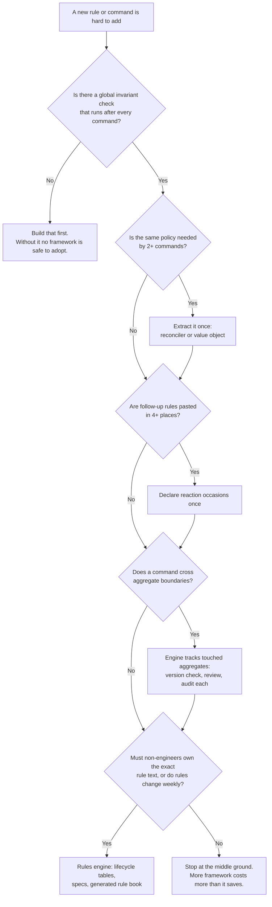

# When to invest in a rules framework

Deliverable 3. It is a decision guide built from signals you can measure in a codebase like field-desk, not from taste. The three options are the ones this take-home compared:

- **Patterns only.** Hand-written services plus a few shared helpers. This was field-desk before this work.
- **Middle ground (solution A).** The services keep their handlers, but cross-cutting rules live in one place: a capacity reconciler for release policies, declared reaction occasions, a multi-account engine and value objects. This is what was built here, in part.
- **Rules engine (solution B).** Rules as data: lifecycle tables, `when/then` specs, invariants named by rule ID, and a rule book generated from the specs. This was designed but not built.

## 1. Signals to measure

| Signal | How to measure it | field-desk before | Points towards |
| --- | --- | --- | --- |
| **Reaction sites** | Places that hand-call a follow-up rule, e.g. `allocateCash(); refresh()` | 6 pasted tails | ≥ 4 sites: declare reactions once (A) |
| **Duplicated policy code** | Distinct code paths implementing the same release or settlement policy | 1 (returns), then 2 more needed (FDSK-169, FDSK-170) | ≥ 2 users of one policy: extract a reconciler (A) |
| **Commands × derived ledgers** | Commands that write a fact multiplied by ledgers derived from it (cash, credit, points, quantities) | 20 × 4 | Above roughly 40: invest in derivation (A); above roughly 150, with frequent change, consider B |
| **Files touched per rule change** | Median files in commits that change one rule | 3 to 5 (service, test, docs, client label) | > 5 on a regular basis: A; rule text drifting from code: B |
| **Cross-aggregate commands** | Commands that must change two consistency boundaries atomically | 0, then 1 (FDSK-169) | ≥ 1: the engine must know about touched aggregates (A); a DSL doesn't help here |
| **Rule change frequency** | Rule edits per month that need no new behaviour, only new parameters or orders | Low: rules are versioned business terms | Weekly parameter changes: B (rules as data) |
| **Who signs off** | Must non-engineers approve the exact rule text that runs? | Rules doc reviewed by the business; code checked by tests | Yes, and the text must be the source of truth: B with a generated rule book |
| **Invariant coverage** | Is there a global post-condition check, like `AuditService.review`? | Yes, 14 checks after every command | If yes, refactoring is cheap and A is low-risk. If no, build that first, before any framework |

## 2. Decision tree

## 3. Costs to weigh

| | Patterns only | Middle ground (A) | Rules engine (B) |
| --- | --- | --- | --- |
| Framework code to own | 0 | Hundreds of lines (here: about 250 for the reconciler and engine changes) | 1,500+ lines, plus tooling for the rule book |
| Debugging | Stack traces in the domain service | Same, with one extra hop into the reconciler | Through the engine: harder, and needs good tracing |
| Onboarding | Read the services | Read the services plus a few named policies | Learn the DSL and the engine semantics |
| Risk of the abstraction being wrong | None | Low: each piece has 2+ real users before it is extracted | High if the rules aren't yet stable |
| Readability for non-engineers | Low (rules hide in code) | Medium (rule IDs in code, declared policies) | High (generated rule book) |

## 4. Rules of thumb from this take-home

1. **Extract on the second user, not the first.** The WF-003 release was only worth extracting once FDSK-170 needed the same release. The reconciler then made FDSK-170 a handler that records facts only, with no settlement code of its own.
2. **Not every reaction should be reactive.** WF-002 explicitly says that some operations must *not* trigger cash allocation. A purely table-triggered reaction system would break that rule. Keep occasion lists where the business defines occasions.
3. **Cross-aggregate work belongs to the engine.** "Version-check, bump, audit and review every account you touched" is one rule in the engine. Without it, every two-account command would repeat it, and one would eventually forget.
4. **Characterize before you abstract.** Pinning the exact ledger rows a return writes made the refactor provably behaviour-preserving. That safety net cost less than an hour.
5. **A global invariant check is the cheapest framework.** `AuditService.review` caught nothing in this work because nothing broke. Its value is that a broken refactor could not have committed.

## 5. When this guide is wrong

- The thresholds above are judgement calls from one codebase of about 7.4k lines with 20 commands. Treat them as starting points to calibrate, not constants.
- Regulated domains, where an auditor must read the running rule, can justify B much earlier than the tree suggests.
- If the team is about to rewrite the storage model, skip both A and B until the storage settles.
